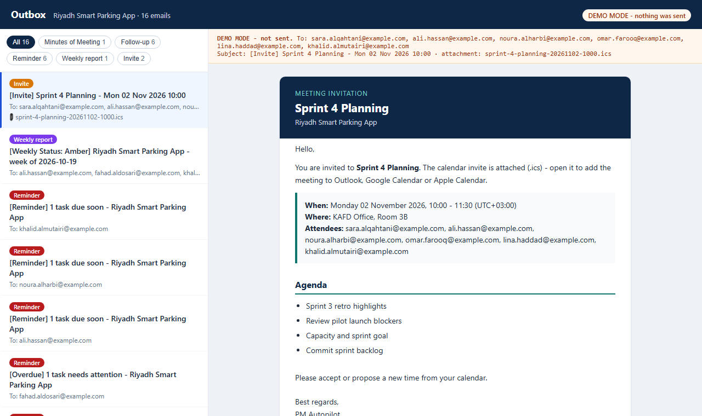
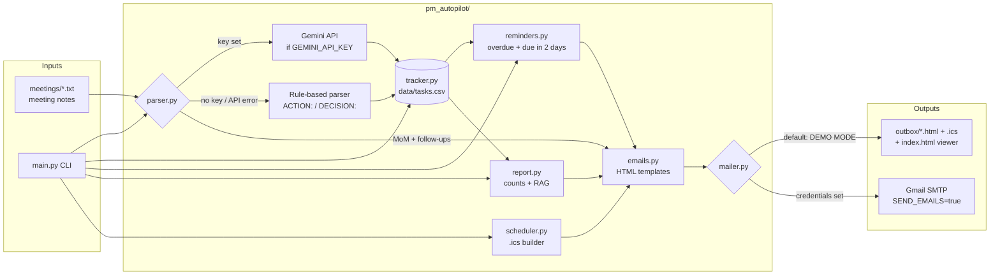
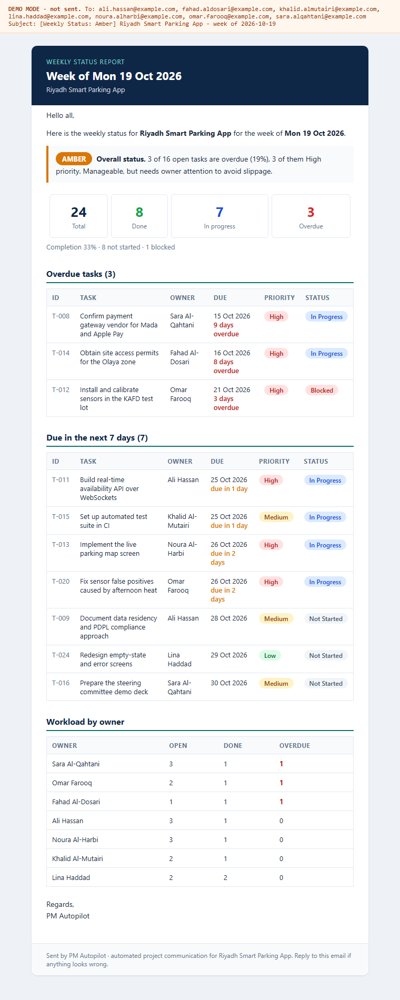
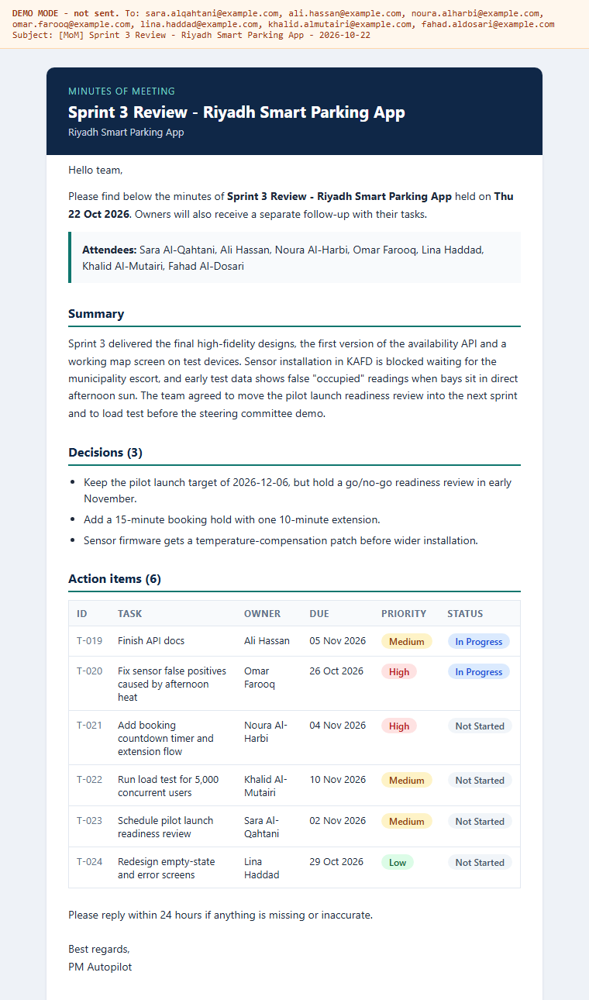
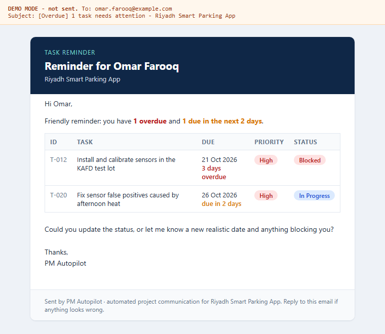
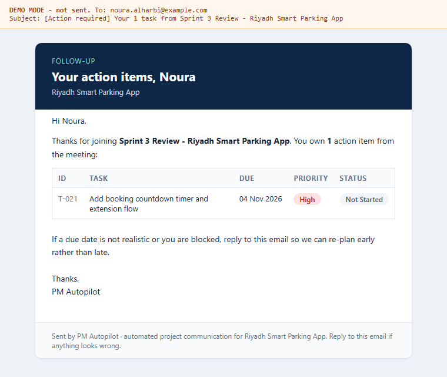
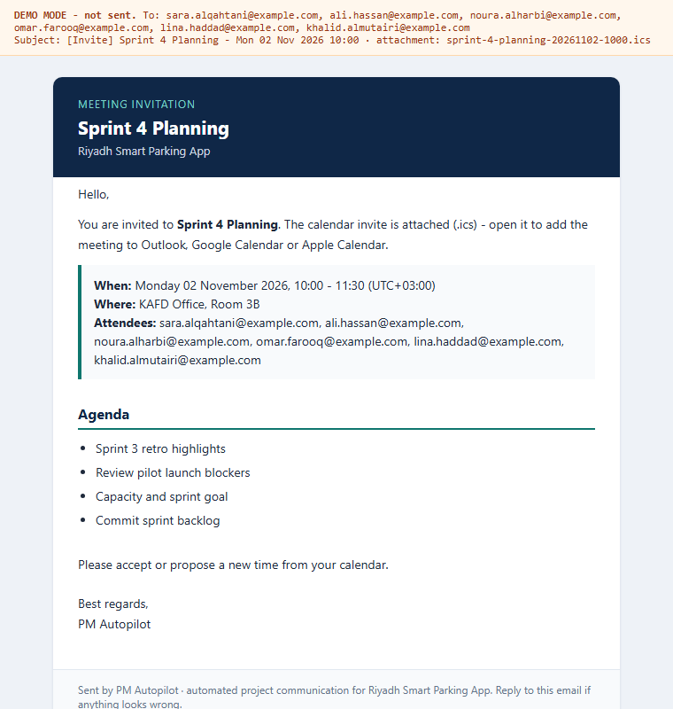

# PM Autopilot

**Project management on autopilot. Write meeting notes; get minutes, a task tracker, follow-ups, reminders, weekly status reports and calendar invites.**

  -orange) 

- **Free.** Runs on your computer. The AI part (Google Gemini) has a free tier, and it's optional.
- **Safe by default.** Nothing is emailed until you switch it on. Until then, every email is saved for you to preview. Once it's on, it still asks before sending.
- **Simple.** One install command, plain-text meeting notes, and a CSV task list you can open in Excel.



---

## Contents

1. [The problem](#the-problem)
2. [Quick start (2 minutes)](#quick-start-2-minutes)
3. [Use it for your own project](#use-it-for-your-own-project)
4. [Command reference](#command-reference)
5. [Optional: AI parsing and real email sending](#optional-ai-parsing-and-real-email-sending)
6. [Run it automatically every day](#run-it-automatically-every-day)
7. [Troubleshooting](#troubleshooting)
8. [How it works](#how-it-works)
9. [Sample output](#sample-output)
10. [Skills demonstrated](#skills-demonstrated)

---

## The problem

Project managers spend hours every week on communication overhead instead of the project:

- Turning messy meeting notes into **Minutes of Meeting** and chasing people to confirm their action items.
- Copying action items into a tracker by hand, which leads to **duplicates, missing owners and missing due dates**.
- Checking who is late and writing **reminder emails** one by one.
- Building the **weekly status report**: counting tasks, listing what's overdue, deciding Red, Amber or Green.
- Sending **calendar invites** with the right attendees and agenda.

None of this needs judgment every time. It needs consistency. **PM Autopilot handles the routine work so you can focus on risks, people and decisions.**

## Features

| | Feature | What it does |
|---|---------|--------------|
| 📝 | **Meeting notes processing** | Reads a `.txt` file and extracts the **summary, decisions and action items** (task, owner, email, due date, priority). Uses **Google Gemini** if you add a free key, otherwise a simple **rule-based parser**. If Gemini fails, it falls back to the rule-based parser automatically. |
| ✅ | **Task tracker** | Keeps every action item in `data/tasks.csv`, which opens in Excel or Google Sheets. **Never duplicates** a task, even if you process the same notes twice. |
| 📧 | **Stakeholder emails** | A professional **HTML Minutes of Meeting** for all attendees, plus a **personal follow-up** to each owner listing only their tasks. |
| ⏰ | **Reminders** | Finds tasks that are **overdue or due within 2 days** and sends **one email per person**, not one per task. |
| 📊 | **Weekly status report** | **Done / In progress / Overdue** counts, an overdue table, what's due next week, workload per person, and an overall **RAG status** with its reason. |
| 📅 | **Meeting scheduler** | Creates a **`.ics` calendar invite** that works in Outlook, Google Calendar and Apple Calendar. |
| 👀 | **Outbox viewer** | `python main.py serve` opens an inbox-style page in your browser to preview every email before anything is sent. |

## Quick start (2 minutes)

You need **Python 3.10 or newer** ([download](https://www.python.org/downloads/)). On Windows, tick *"Add python.exe to PATH"* during install.

```bash
# 1. Get the code
git clone https://github.com/RAJA-SUFIAN/pm-autopilot.git
cd pm-autopilot

# 2. Install (one small dependency)
pip install -r requirements.txt

# 3. Run the full workflow on the sample project, then look at the results
python main.py demo
python main.py serve
```

`serve` opens **http://localhost:8765** in your browser with all the generated emails. Press `Ctrl+C` in the terminal to stop it.

> **Tip:** if `python` isn't found on Windows, use `py` instead (`py main.py demo`). On macOS or Linux you may need `python3`.
>
> The sample data is dated around 24 Oct 2026. Add `--today 2026-10-24` to any command to reproduce the exact sample output.

## Use it for your own project

The repo ships with a sample project, *Riyadh Smart Parking App*. To switch to your own:

**1. Set your project name.** Copy the settings file and edit `PROJECT_NAME`:

```bash
cp .env.example .env        # Windows (cmd): copy .env.example .env
```

**2. Clear the sample tasks.** A backup copy is kept automatically:

```bash
python main.py reset --yes
```

**3. Write your meeting notes.** Copy [`templates/meeting_notes_template.txt`](templates/meeting_notes_template.txt) into `meetings/` and fill it in:

```text
TITLE: Weekly Sync - Website Redesign
DATE: 2026-11-02
ATTENDEES: Maria Lopez <maria@company.com>, Ken Ito <ken@company.com>
SUMMARY: Homepage design approved; content migration starts next week.
DECISION: Launch date stays 2026-12-01.
ACTION: Maria - finalize homepage copy - 2026-11-06 - High
ACTION: Ken - migrate blog posts - 2026-11-13
```

- `ACTION:` lines use the format **Owner - task - due date - priority**. Priority is optional and defaults to Medium.
- Owners can be first names. They're matched to `ATTENDEES` to fill in the full name and email.
- With a Gemini key, you can skip the tags and write naturally, e.g. "Ken will migrate the blog posts by next Friday".

**4. Process the notes.** This updates the tracker, then writes the minutes and follow-up emails:

```bash
python main.py process meetings/2026-11-02_weekly_sync.txt
```

**5. Keep the tracker up to date** as work moves. Do it from the terminal, or just edit `data/tasks.csv` in Excel:

```bash
python main.py tasks --open                         # see what's open
python main.py update T-003 --status "in progress"
python main.py update T-001 T-002 --status done     # several at once
python main.py update T-004 --due 2026-11-20        # move a due date
python main.py add "Book launch venue" --owner Maria --due 2026-11-15 --priority high
```

**6. Send reminders and the weekly report:**

```bash
python main.py reminders        # e.g. every morning
python main.py weekly-report    # e.g. every Thursday
```

**7. When you're happy with the previews, turn on real sending.** See [Gmail setup](#gmail-send-real-emails) below.

## Command reference

| Command | What it does |
|---------|--------------|
| `python main.py process <notes.txt>` | Extract minutes and action items, update the tracker, write the MoM and follow-up emails. Add `--no-emails` to only update the tracker. |
| `python main.py reminders` | Remind owners of tasks that are overdue or due within 2 days. `--window 5` widens it to 5 days. |
| `python main.py weekly-report` | Weekly status email with the RAG rating. |
| `python main.py schedule --title "Sprint Planning" --date 2026-11-02 --time 10:00 --attendees a@x.com,b@x.com` | Create a calendar invite. Optional: `--duration 90`, `--location "Room 3"`, `--agenda "Retro; Backlog; Goal"`. |
| `python main.py tasks [--open]` | Print the task list. `--open` hides finished tasks. |
| `python main.py add "<task>" --owner <name> [--email] [--due] [--priority]` | Add a task by hand. |
| `python main.py update <ID...> [--status] [--due] [--priority] [--owner] [--email]` | Change one or more tasks. Statuses: `Not Started`, `In Progress`, `Blocked`, `Done`. |
| `python main.py reset --yes` | Empty the tracker to start a new project. A backup is kept. |
| `python main.py check [--send-test]` | Check your setup and say exactly what to fix. `--send-test` emails you a test message. |
| `python main.py serve [--port 8765]` | Browse the generated emails in your browser. |
| `python main.py demo` | Run process, reminders, weekly report and schedule on the sample project. |

Every command accepts `--today YYYY-MM-DD` to pretend it's another date, which is handy for testing, and `--yes` to skip confirmation questions. Run `python main.py <command> -h` for help on any command.

## Optional: AI parsing and real email sending

All settings live in `.env`. Copy it from [`.env.example`](.env.example), which explains every option. After changing anything, run:

```bash
python main.py check
```

### Gemini: understand free-form notes

1. Get a free API key at <https://aistudio.google.com/apikey>.
2. In `.env`, set `GEMINI_API_KEY=your-key`.
3. Run `python main.py check`. It should show `[OK] Gemini AI`.

Your notes are sent to Google's Gemini API for processing. If that's not acceptable for your meetings, leave the key empty and the rule-based parser runs entirely on your computer.

### Gmail: send real emails

Gmail needs an **App Password**, not your normal password:

1. Turn on [2-Step Verification](https://myaccount.google.com/signinoptions/two-step-verification) for your Google account.
2. Create an App Password at <https://myaccount.google.com/apppasswords>. It's 16 characters.
3. In `.env`, set:
   ```ini
   SEND_EMAILS=true
   GMAIL_ADDRESS=you@gmail.com
   GMAIL_APP_PASSWORD=abcd efgh ijkl mnop
   ```
4. Send yourself a test: `python main.py check --send-test`

With sending on, every command **shows who will be emailed and asks `Send now? [y/N]`** before anything goes out. Add `--yes` to skip the question, for example in scheduled runs.

> **Before emailing your team for real,** run a command once with `SEND_EMAILS=false` and preview the results with `python main.py serve`.

Your `.env` file is listed in `.gitignore`, so your keys are never committed.

## Run it automatically every day

**Windows: Task Scheduler**

1. Open *Task Scheduler*, then choose *Create Basic Task*, name it "PM reminders", and set the trigger to *Daily* at 08:00.
2. Action: *Start a program*.
   - Program: the full path to `python.exe`. Run `where python` in a terminal to find it.
   - Arguments: `main.py reminders --yes`
   - Start in: the folder where you cloned pm-autopilot.
3. Repeat for `main.py weekly-report --yes` with a *Weekly* trigger.

**macOS / Linux: cron** (run `crontab -e`)

```cron
0 8 * * 1-5  cd /path/to/pm-autopilot && /usr/bin/python3 main.py reminders --yes
0 9 * * 4    cd /path/to/pm-autopilot && /usr/bin/python3 main.py weekly-report --yes
```

`--yes` is needed because nobody is there to answer the "Send now?" question. Without it, a scheduled run sends nothing and prints a message saying so.

## Troubleshooting

| Problem | Fix |
|---------|-----|
| `python` not found | On Windows use `py`. On macOS/Linux use `python3`. Or reinstall Python with "Add to PATH" ticked. |
| `No module named dotenv` | Run `pip install -r requirements.txt`. |
| An action item was skipped | Check the line follows `ACTION: Owner - task - YYYY-MM-DD`, with spaces around each dash. The terminal shows a warning for lines it couldn't read. |
| Owner gets no emails | Their email is missing. Add them to `ATTENDEES` in the notes, or run `python main.py update T-005 --email them@company.com`. |
| `Gmail login rejected` | Use an **App Password**, not your normal password. 2-Step Verification must be on. |
| Gemini errors / quota | The tool automatically falls back to the rule-based parser. Run `python main.py check` to see the exact error. |
| Scheduled run sent nothing | Add `--yes` to the command in Task Scheduler / cron. Real sending asks for confirmation otherwise. |
| Port 8765 is busy | `serve` picks the next free port automatically, or use `--port 9000`. |
| I want the sample data back | `git checkout data/tasks.csv` |

## How it works



| Module | Responsibility |
|--------|----------------|
| `main.py` | Command-line interface (argparse) |
| `pm_autopilot/parser.py` | Gemini extraction (JSON output), rule-based fallback, matching owners to emails |
| `pm_autopilot/tracker.py` | CSV task store, de-duplication, IDs, updates |
| `pm_autopilot/reminders.py` | Detecting due-soon and overdue tasks, grouped per owner |
| `pm_autopilot/report.py` | Status counts, overdue list, workload, RAG rules |
| `pm_autopilot/scheduler.py` | Standards-compliant `.ics` generation |
| `pm_autopilot/emails.py` | Email-client-safe HTML templates (inline CSS, table layout) |
| `pm_autopilot/mailer.py` | DEMO MODE outbox, or Gmail SMTP with HTML and plain-text parts |
| `pm_autopilot/outbox_index.py`, `server.py` | Outbox viewer page and local web server |
| `pm_autopilot/doctor.py` | `check` command: setup diagnostics |

### RAG rules

| Status | Rule (share of **open** tasks that are overdue) |
|--------|-----------------------------------------------|
| 🟢 Green | 10% or less, and no High-priority task overdue |
| 🟠 Amber | More than 10%, **or** any High-priority task overdue |
| 🔴 Red | More than 25%: delivery at risk, recovery plan needed |

## Sample output

These are real DEMO MODE output from `python main.py demo --today 2026-10-24`.

| Weekly status report | Minutes of Meeting |
|---|---|
|  |  |

| Overdue reminder | Owner follow-up | Meeting invite (.ics attached) |
|---|---|---|
|  |  |  |

<details>
<summary><strong>Terminal output</strong></summary>

```text
=== process =====================================================
Processed meetings\sprint_review.txt (parser: rules)
  Title:        Sprint 3 Review - Riyadh Smart Parking App
  Date:         2026-10-22
  Attendees:    7
  Decisions:    3
  Action items: 6
Tracker: 4 added, 2 already tracked -> data\tasks.csv
  + T-021  Noura Al-Harbi     Add booking countdown timer and extension flow  (due 2026-11-04, High)
  + T-022  Khalid Al-Mutairi  Run load test for 5,000 concurrent users  (due 2026-11-10, Medium)
  + T-023  Sara Al-Qahtani    Schedule pilot launch readiness review  (due 2026-11-02, Medium)
  + T-024  Lina Haddad        Redesign empty-state and error screens  (due 2026-10-29, Low)
Emails (7, DEMO MODE -> outbox/):
  outbox\mom__sprint-3-review-riyadh-smart-parking-app-2026-10-22.html
  ...

=== reminders ===================================================
Reminders for 2026-10-24 (overdue or due within 2 days): 6 owner(s)

=== weekly-report ===============================================
Weekly status for week of 2026-10-19: Amber
  3 of 16 open tasks are overdue (19%), 3 of them High priority. Manageable, but needs owner attention to avoid slippage.
  Total 24 | Done 8 | In progress 7 | Overdue 3 | Blocked 1 | Not started 8

=== schedule ====================================================
Scheduled 'Sprint 4 Planning' on Mon 02 Nov 2026 10:00 (UTC+03:00), 90 min, 6 attendee(s)
```
</details>

## Running the tests

```bash
python -m pytest
```

The tests cover parsing (including mocked Gemini responses, no network), tracker de-duplication and updates, reminder windows, RAG thresholds, `.ics` formatting, the email output and every CLI command. They run offline, and GitHub Actions runs them on Windows and Linux on every push.

## Skills demonstrated

- **Automation:** replaced manual PM chores (minutes, tracker updates, chasing, reporting, scheduling) with a single CLI. Every step is idempotent and safe to re-run.
- **Stakeholder communication:** tailored messages per audience: full minutes for attendees, personal follow-ups for owners, reminders for people who are behind, and an executive RAG summary for leadership.
- **Task tracking:** a structured tracker with owners, due dates, priorities, statuses and traceability to the source meeting.
- **Reporting:** objective status metrics, overdue analysis, workload by owner and a transparent, rule-based RAG rating.
- **Applied AI with graceful degradation:** an LLM (Gemini) used for structured JSON extraction, with a deterministic fallback.
- **Product thinking:** safe-by-default delivery, a setup checker with actionable errors, a preview UI, and docs written for non-developers.

## Contributing

Issues and pull requests are welcome. Ideas: Jira, Trello or Google Sheets sync; reading Teams or Google Meet transcripts; Outlook SMTP support; a burndown chart in the weekly report.

## License

[MIT](LICENSE). Free to use, modify and share.

*All people, emails (`@example.com`) and project details in the sample data are fictional.*
